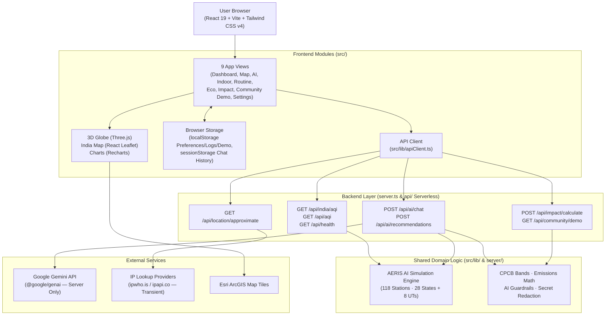

# AERIS AI

### Breathe Smarter. Live Better.

**Created and Developed by Annanya Bagga**

[](https://aeris-ai-01.vercel.app/)
[](https://react.dev/)
[](https://www.typescriptlang.org/)
[](https://vite.dev/)
[](https://expressjs.com/)
[](https://ai.google.dev/)

**AERIS AI** is an AI-powered environmental technology and air quality monitoring assistant built for Indian households and commuters. It combines an interactive 3D atmospheric Earth visualization, a Leaflet-based India-wide monitoring map, deterministic India-wide simulated AQI telemetry across all **28 Indian states and 8 Union Territories**, indoor air optimization tools, adaptive daily routine planning, commute CO2e impact calculation, an interactive login-free Community Sustainability Hub (Demo Mode), and a server-side Google Gemini conversational advisor.

> **Transparency Notice:** Air quality readings in AERIS AI are generated by the built-in **AERIS AI Simulation Engine** (`SIMULATED` data) for demonstration and educational planning. They are **not** live government or Central Pollution Control Board (CPCB) sensor measurements and should not be used for medical or emergency decisions.

---

## Table of Contents

- [Live Demo](#live-demo)
- [About the Project](#about-the-project)
- [Key Features](#key-features)
- [Technology Stack](#technology-stack)
- [Project Architecture](#project-architecture)
- [How to Run Locally](#how-to-run-locally)
- [Environment Variables](#environment-variables)
- [API Documentation](#api-documentation)
- [Gemini AI Configuration](#gemini-ai-configuration)
- [Deployment on Vercel](#deployment-on-vercel)
- [Data Accuracy and Privacy](#data-accuracy-and-privacy)
- [Project Folder Structure](#project-folder-structure)
- [Troubleshooting](#troubleshooting)
- [Future Improvements](#future-improvements)
- [Contribution Guidelines](#contribution-guidelines)
- [License](#license)
- [Author and Contact](#author-and-contact)
- [Acknowledgements](#acknowledgements)

---

## Live Demo

Experience the deployed web application on Vercel:

- **Live URL:** [https://aeris-ai-01.vercel.app/](https://aeris-ai-01.vercel.app/)

[](https://aeris-ai-01.vercel.app/)

---

## About the Project

Urban air pollution and seasonal winter smog affect millions of residents across Indian cities—from dense northern plains metros to coastal, southern, eastern, western, central, northeastern, and island regions. Even when people see an AQI number, it is often unclear how to translate pollutant metrics into practical daily choices: when to ventilate a room, what air purifier CADR fits a bedroom, whether walking or cycling is safe today, or how to adjust schedules for children and older adults.

**AERIS AI** addresses this gap by pairing pan-India air quality visualization with actionable, household-aware guidance:

- **Intended Users:** Indian families, parents planning school commutes, older adults and pollution-sensitive households, daily commuters comparing lower-emission transit modes, and environmentally conscious residents.
- **Core Purpose:** Turn India-wide AQI categories (Good, Satisfactory, Moderate, Poor, Very Poor, Severe) and pollutant profiles (`PM2.5`, `PM10`, `NO2`, `SO2`, `CO`, `O3`, `NH3`) into clear, non-medical precautionary recommendations, indoor air strategies, and sustainable habit tracking.
- **Environmental Awareness Goals:** Encourage lower-emission commuting (metro rail, bus, carpooling, EV cab, and safe active mobility when air quality permits), raise awareness of indoor pollution sources (cooking smoke, incense, mosquito coils), and support interactive community sustainability challenges.

---

## Key Features

The table below documents every implemented feature in the codebase and clearly distinguishes live/working modules from simulated or demo functionality.

| Feature | Status | Implementation Details |
| --- | --- | --- |
| **Air Quality Dashboard & 3D Atmospheric Globe** | Working (`SIMULATED` AQI) | Displays selected city AQI, CPCB category badge, predominant pollutant, pollutant cards, station switcher, state-by-state comparison table, CPCB health guidance panel, and an interactive **Three.js** 3D Earth (`EarthScene.tsx`) with surface/normal/specular/cloud textures, atmospheric glow shader, AQI-reactive urban pollution halos/particles, station markers, and Pause/Focus controls. |
| **India-Wide AQI Map** | Working (`SIMULATED` AQI) | Interactive **React Leaflet + Leaflet + Leaflet.markercluster** map (`IndiaStationMap.tsx`) over Esri ArcGIS dark gray and satellite imagery basemaps. Plots **118 stations** across **all 28 Indian states and 8 Union Territories** using fixed city/station coordinates, with state, city, search, and CPCB category filters, marker clustering, fullscreen mode, and station inspection drawers. |
| **Simulated India-Wide Air Quality API** | Working (`SIMULATED`) | Deterministic **AERIS AI Simulation Engine** (`src/lib/indiaSimulation.ts`) serving consistent JSON snapshots on a configurable interval (default 15 minutes) across 28 states and 8 UTs with explicit `SIMULATED` metadata and disclaimers. |
| **City & Location Detection** | Working (Multi-tier fallback) | Attempts browser `navigator.geolocation` first (with `Permissions-Policy` and denial detection), falls back to server-side approximate IP city detection (`GET /api/location/approximate` via `ipwho.is` with `ipapi.co` fallback, zero coordinate storage, strict IP validation), and provides a searchable manual selector covering all Indian states and UTs. |
| **AI-Powered Air Quality Advisor** | Working (Server-side `GEMINI_API_KEY`) | Conversational assistant (`AiAssistantPage.tsx`) backed by server-side `@google/genai` (`POST /api/ai/recommendations` and `POST /api/ai/chat`) on both Express and Vercel Serverless Functions. Grounds responses in current simulated city/station context, household preferences, and bounded session history (up to 8 turns), enforcing non-medical and transparency guardrails. |
| **Indoor Air Quality Optimizer** | Working | Room dimensions calculator (`IndoorOptimizerPage.tsx`) computing room area, volume, dynamic Air Changes per Hour (ACH) based on outdoor AQI, and recommended purifier CADR; adaptive ventilation schedules; True HEPA / DIY box-fan / no-purifier guidance; practical hygiene checklist saved in `localStorage`; and science-backed caveats (explicitly rejecting houseplant air-cleaning myths). |
| **Smart Daily Routine Planner** | Working | Generates personalized Morning, Afternoon, and Evening routines (`RoutinePlannerPage.tsx`) tailored to household profile (children, older adults, pollution-sensitive members, office/school/home schedule, exercise preference) and current AQI band, with a daily resettable checklist stored in `localStorage`. |
| **Eco-Friendly Alternatives & Commute Calculator** | Working | Compares solo car and two-wheeler commutes against metro rail, public bus, carpool, EV cab, walking, and cycling (`EcoAlternativesPage.tsx`) using sourced India transport emission factors (`src/lib/emissions.ts`), calculates CO2e avoided, and enforces an AQI safety gate that blocks unsafe outdoor walking/cycling recommendations during high pollution. |
| **Environmental Impact Tracker** | Working (Browser `localStorage`) | Logs personal eco-commute and indoor-air actions (`ImpactTrackerPage.tsx`), tracks streaks, displays monthly/weekly **Recharts** visualizations, and separates quantified CO2e-avoided actions from qualitative habits without inventing numbers. |
| **Community Sustainability Hub** | Working (Login-Free Demo Mode) | Fully interactive **Demo Mode** (`CommunityHubPage.tsx` + `src/lib/communityDemoEngine.ts`) requiring zero login or account setup. Supports logging simulated eco actions (with client-side PII filtering), joining/leaving seasonal challenges, filtering by city, viewing a demo participant leaderboard and achievements, and resetting local demo state. |
| **Preferences & Health Diagnostics** | Working | Household configuration (city, household size, children, older adults, sensitivity, commute mode, work hours, anonymous handle), live backend health inspection (`GET /api/health`), and non-secret Gemini & simulation status indicators (`SettingsPage.tsx`). |
| **Responsive & Accessible UI** | Working | Adaptive layout with desktop sidebar, Escape-closable mobile navigation drawer, bottom mobile quick-dock, skip-to-main-content link, keyboard-accessible interactive rows/controls, global `:focus-visible` focus rings, reduced-motion support, and React error boundaries. |

---

## Technology Stack

Verified directly from `package.json` and project source files:

### Frontend
- **Framework:** React `19` (`react`, `react-dom`)
- **Language:** TypeScript (`typescript`, strict mode enabled in `tsconfig.json`)
- **Build Tool & Dev Bundler:** Vite `8` (`vite`, `@vitejs/plugin-react`)
- **Styling:** Tailwind CSS `v4` (`tailwindcss`, `@tailwindcss/vite`)
- **Animations:** Motion (`motion` / `motion/react`)
- **Icons:** Lucide React (`lucide-react`)
- **3D Visualization:** Three.js (`three`) with custom shaders and Earth texture maps (`public/textures/earth/`)
- **Geospatial Mapping:** Leaflet (`leaflet`), React Leaflet `v5` (`react-leaflet`), Leaflet.markercluster (`leaflet.markercluster`), Esri ArcGIS Dark Gray & World Imagery map tiles
- **Charts & Data Visualization:** Recharts (`recharts`)

### Backend & Serverless
- **Runtime:** Node.js (ESM, `"type": "module"`)
- **Web Server:** Express `4` (`express`) in `server.ts`
- **TypeScript Runner:** `tsx` (development server and `node:test` unit test suite)
- **Serverless Handlers:** Native Node `http` (`IncomingMessage` / `ServerResponse`) functions in `api/` for Vercel deployment (`vercel.json`)
- **Environment Loading:** `dotenv`

### AI Integration
- **AI SDK:** Google Gen AI SDK (`@google/genai`) invoked exclusively server-side in `server/ai/gemini.ts` (`gemini-3.1-flash-lite` primary with automatic fallback to `gemini-4-hydrogen`)

### Deployment & Hosting
- **Live Hosting:** Vercel ([https://aeris-ai-01.vercel.app/](https://aeris-ai-01.vercel.app/))

---

## Project Architecture

AERIS AI uses a unified TypeScript architecture with pure, shared domain modules (`src/lib/`) and shared server utilities (`server/`) reused across the React frontend, the Express server (`server.ts`), and all 8 Vercel serverless API handlers (`api/`):

1. **React SPA (`src/`):** Manages navigation across 9 views (`Dashboard`, `Pollution Map`, `AI Advisor`, `Indoor Air`, `Daily Routine`, `Eco Transport`, `Impact Tracker`, `Community Hub`, `Preferences`), persists household settings, checklists, impact logs, and Demo Community state in browser `localStorage` (and session chat history in `sessionStorage`), and communicates with same-origin `/api/*` endpoints via `src/lib/apiClient.ts`.
2. **Express Server (`server.ts`) & Vercel Serverless API Layer (`api/`):** Expose identical JSON endpoints for `/api/health`, `/api/india/aqi`, `/api/aqi`, `/api/location/approximate`, `/api/ai/recommendations`, `/api/ai/chat`, `/api/impact/calculate`, and `/api/community/demo`, sharing response helpers (`server/http.ts`), IP validation (`server/location.ts`), secret redaction (`server/security.ts`), and Gemini request handling (`server/ai/handler.ts`).
3. **Simulation Engine (`src/lib/indiaSimulation.ts` & `src/lib/aqi.ts`):** Generates deterministic India-wide AQI and pollutant values for 118 fixed station coordinates spanning 28 states and 8 UTs, classified using CPCB 0–500 thresholds.
4. **Server-Side AI Layer (`server/ai/gemini.ts`):** Reads `GEMINI_API_KEY` exclusively on the server, injects current simulated AQI context, household profile, and strict non-medical/transparency instructions, requests structured JSON output from `@google/genai`, and enforces response guardrails (`src/lib/aiContext.ts`).



---

## How to Run Locally

### Prerequisites

- **Node.js:** v20.x or higher recommended (**Node.js v22+** required if running `npm start` directly via `node server.ts`).
- **npm:** Included with Node.js (matches all scripts in `package.json`).
- **Optional Credentials:**
  - A **Google Gemini API key** (`GEMINI_API_KEY`) for live AI Advisor responses.
  - *(The Dashboard, 3D Earth, India AQI Map, Indoor Optimizer, Routine Planner, Eco Calculator, Impact Tracker, and Community Hub Demo Mode run out of the box without any external API keys.)*

### Step 1: Install Dependencies

```bash
npm install
```

### Step 2: Configure Environment Variables

Create a `.env` file in the project root by copying `.env.example`:

```bash
cp .env.example .env
```

Set `GEMINI_API_KEY` in `.env` if you want live AI Advisor responses. Never commit `.env` to Git—it is excluded by `.gitignore`.

### Step 3: Start the Development Server

```bash
npm run dev
```

Open [http://localhost:3000](http://localhost:3000) in your browser and optionally check [http://localhost:3000/api/health](http://localhost:3000/api/health).

### `package.json` Scripts

```bash
npm run dev      # Full-stack Express + Vite dev server on port 3000
npm run lint     # Strict TypeScript type-checking (tsc --noEmit)
npm test         # Run full unit test suite (src/lib, server, server/ai)
npm run build    # Build production frontend bundle into dist/
npm start        # Run production Express server (node server.ts) on port 3000
npm run preview  # Preview static Vite build locally
npm run clean    # Remove dist/ and server.js build artifacts
```

---

## Environment Variables

All environment variables referenced in the codebase are listed below:

| Variable Name | Scope | Required / Optional | Purpose |
| --- | --- | --- | --- |
| `GEMINI_API_KEY` | **Backend only** | Optional *(Required for AI Advisor)* | Server-side API key for `@google/genai` used by `POST /api/ai/recommendations` and `POST /api/ai/chat`. |
| `GEMINI_MODEL` | **Backend only** | Optional *(Default: `gemini-3.1-flash-lite` -> `gemini-4-hydrogen`)* | Optional active Gemini model override (deprecated models are ignored automatically). |
| `SIMULATION_INTERVAL_MS` | **Backend only** | Optional *(Default: `900000` = 15 min)* | Deterministic refresh interval (ms) for the AERIS AI India-wide simulated AQI engine. |
| `PORT` | **Backend only** | Optional *(Default: `3000`)* | Listening port for the Express server (`server.ts`). |
| `NODE_ENV` | **Backend only** | Optional | Set to `production` to serve built `dist/` static assets from `server.ts`. |
| `APP_URL` | **Backend / Docs** | Optional *(Default: `http://localhost:3000`)* | Public base URL reference where the app is hosted. |
| `VITE_API_BASE_URL` | **Frontend** | Optional *(Leave empty for same-origin)* | Optional backend origin only if frontend and API are deployed on separate domains (production hosts ignore accidental localhost/preview values). |
| `VITE_API_PROXY_TARGET` | **Dev Tooling** | Optional | Target origin used by `vite.config.ts` to proxy `/api` when running standalone `vite`. |
| `DISABLE_HMR` | **Dev Tooling** | Optional | When set to `true`, disables Vite HMR and file watching in hosted IDE sandboxes. |

### Security Boundaries
- **Never** prefix `GEMINI_API_KEY` with `VITE_` or expose it in frontend code.
- Error responses redact key patterns (`AIza...`, `Bearer ...`) via `server/security.ts`.

---

## API Documentation

> **Important:** All AQI endpoints return **`SIMULATED`** data generated by the **AERIS AI Simulation Engine** for demonstration purposes. None of these endpoints connect to CPCB, `data.gov.in`, or live physical air quality monitors.

All 8 API routes are supported on both Express (`server.ts`) and Vercel Serverless Functions (`api/`):

| Method & Route | Serverless File | Purpose |
| --- | --- | --- |
| `GET /api/health` | `api/health.ts` | Non-secret service health, simulation coverage, and `geminiConfigured` status. |
| `GET /api/india/aqi` | `api/india/aqi.ts` | All 118 simulated stations across 28 states & 8 UTs (supports `state`, `city`, `category`, `search`, `includeCityDetail`, `station`). |
| `GET /api/aqi` | `api/aqi.ts` | Single-city simulated AQI, station list, and pollutant metrics (defaults to `Delhi`). |
| `GET /api/location/approximate` | `api/location/approximate.ts` | Transient, zero-storage approximate IP city detection (`ipwho.is` / `ipapi.co`) with strict IP syntax validation. |
| `POST /api/ai/recommendations` | `api/ai/recommendations.ts` | Server-side Gemini structured recommendation grounded in simulated city AQI, household preferences, and bounded history. |
| `POST /api/ai/chat` | `api/ai/chat.ts` | Alias of `/api/ai/recommendations` accepting `question` or `message`. |
| `POST /api/impact/calculate` | `api/impact/calculate.ts` | Validates commute inputs and calculates weekly/monthly kg CO2e avoided plus AQI active-mobility safety. |
| `GET /api/community/demo` | `api/community/demo.ts` | Returns clearly labeled simulated demo challenges and sample community contributions. |

---

## Gemini AI Configuration

The **AI Advisor** (`AiAssistantPage.tsx`) uses `@google/genai` strictly on the backend (`server/ai/gemini.ts`):

1. Create a Gemini API key in [Google AI Studio](https://aistudio.google.com/apikey).
2. Add `GEMINI_API_KEY` to `.env` locally or **Vercel Project Settings > Environment Variables** (server-side only; never `VITE_GEMINI_API_KEY`), then redeploy.
3. `server/ai/gemini.ts` uses `gemini-3.1-flash-lite` (`ThinkingLevel.MINIMAL`) for fast serverless latency with automatic fallback to `gemini-4-hydrogen` (`ThinkingLevel.LOW`), disables slow multi-attempt SDK sleeps so failover fits cleanly inside Vercel's 30s function window, redacts secrets on error, and applies post-processing safety guardrails (`src/lib/aiContext.ts`).
4. If `GEMINI_API_KEY` is unset, `/api/ai/recommendations` and `/api/ai/chat` return HTTP `503` with a clear configuration message without crashing the application.

---

## Deployment on Vercel

**Live Deployment:** [https://aeris-ai-01.vercel.app/](https://aeris-ai-01.vercel.app/)

1. Push the repository to GitHub and import it in [Vercel](https://vercel.com/).
2. Build settings: **Framework Preset:** `Vite`, **Build Command:** `npm run build`, **Output Directory:** `dist`.
3. Add **`GEMINI_API_KEY`** under **Project Settings > Environment Variables** (leave `VITE_API_BASE_URL` unset so all requests use same-origin `/api/*` serverless routes).
4. `vercel.json` configures `maxDuration: 30` for `api/ai/*.ts` and standard security headers (`X-Content-Type-Options`, `Referrer-Policy`, `Permissions-Policy`, `Cross-Origin-Opener-Policy`).

---

## Data Accuracy and Privacy

- **Simulated Air Quality:** All AQI readings (`data_type: "SIMULATED"`, `data_source: "AERIS AI Simulation Engine"`) are deterministic simulations across 118 fixed Indian station coordinates in 28 states and 8 UTs. Guidance is non-medical and precautionary only.
- **Zero GPS Storage:** Browser geolocation coordinates are used transiently in memory only for nearest-city matching and are never stored in `localStorage` or sent to any database.
- **Browser-Local Personal & Demo State:** Household preferences, indoor checklists, daily routines, personal impact logs, and Community Hub Demo Mode actions are stored locally in the user's browser (`localStorage`), and active chat thread history is kept in `sessionStorage` for the current session.

---

## Project Folder Structure

```text
.
├── api/                                # Vercel serverless API handlers (all 8 routes)
│   ├── ai/
│   │   ├── chat.ts                     # POST /api/ai/chat
│   │   └── recommendations.ts          # POST /api/ai/recommendations
│   ├── community/
│   │   └── demo.ts                     # GET /api/community/demo
│   ├── impact/
│   │   └── calculate.ts                # POST /api/impact/calculate
│   ├── india/
│   │   └── aqi.ts                      # GET /api/india/aqi
│   ├── location/
│   │   └── approximate.ts              # GET /api/location/approximate
│   ├── aqi.ts                          # GET /api/aqi
│   └── health.ts                       # GET /api/health
├── public/
│   └── textures/earth/                 # Earth day, normal, specular, cloud & night textures
├── server/
│   ├── adapters/demoData.ts            # Simulated demo community challenges & contributions
│   ├── ai/
│   │   ├── gemini.ts                   # Server-side @google/genai client, model chain & schema
│   │   ├── gemini.test.ts              # Gemini integration & handler unit tests
│   │   └── handler.ts                  # Shared Express/Vercel AI request processor
│   ├── apiHandlers.test.ts             # Serverless endpoint & IP validation unit tests
│   ├── http.ts                         # Shared JSON response & emissions payload validator
│   ├── location.ts                     # Transient IP geolocation resolver with IP validation
│   └── security.ts                     # Secret redaction helper
├── src/
│   ├── components/                     # 3D Earth, Leaflet India Map, CPCB panel, Error boundaries
│   ├── lib/                            # Pure domain engines, guardrails, storage & unit tests
│   ├── pages/                          # 9 application views (Dashboard through Settings)
│   ├── App.tsx                         # Main shell, accessible navigation & error boundaries
│   ├── index.css                       # Tailwind CSS v4 theme & focus-visible accessibility rules
│   └── main.tsx                        # React 19 entry point
├── index.html                          # HTML entry point & SEO/OpenGraph metadata
├── metadata.json                       # Application metadata
├── package.json                        # Dependencies and scripts (dev, build, lint, test)
├── server.ts                           # Express + Vite full-stack server
├── tsconfig.json                       # Strict TypeScript compiler configuration
├── vercel.json                         # Vercel function duration & security headers
└── vite.config.ts                      # Vite 8 + React + Tailwind v4 configuration
```

---

## Troubleshooting

- **Missing `GEMINI_API_KEY` (`HTTP 503`):** Set `GEMINI_API_KEY` in `.env` (local) or Vercel Project Environment Variables (production) without a `VITE_` prefix, then restart/redeploy.
- **Gemini Quota (`HTTP 429`):** Wait briefly and click Retry, or attach a billing-enabled Gemini API key in your deployment environment.
- **API 404 locally:** Run `npm run dev` (which starts `server.ts` with Express + Vite middleware) rather than standalone `vite`.
- **Geolocation blocked in iframe:** AERIS AI detects `Permissions-Policy` / permission denial automatically, falls back to approximate IP lookup (`GET /api/location/approximate`), and provides a manual Indian city selector covering all 28 states and 8 UTs.

---

## Future Improvements

The following enhancements are **planned** and not yet implemented:

- **Planned:** Optional integration with verified public live air quality feeds (with strict separation from simulated mode and resilient caching/fallback).
- **Planned:** Historical AQI trend comparison charts and multi-city side-by-side comparison views.
- **Planned:** Multilingual interface support for major Indian regional languages (e.g., Hindi, Tamil, Bengali, Marathi, Telugu, Malayalam).
- **Planned:** Progressive Web App (PWA) installability and opt-in browser notifications for severe smog alerts.
- **Planned:** Automated CI workflow (GitHub Actions) running `npm run lint`, `npm test`, and `npm run build` on every pull request.

---

## Contribution Guidelines

1. Fork the repository and create a branch from `main`.
2. Make your changes in strict TypeScript, keeping secrets strictly server-side and never committing `.env`.
3. Verify locally before opening a Pull Request:
   ```bash
   npm run lint
   npm test
   npm run build
   ```

---

## License

No `LICENSE` file is currently present in this repository, so a formal open-source license has not yet been specified. Until a license is added by the author, all rights remain reserved by **Annanya Bagga**.

---

## Author and Contact

**Annanya Bagga**  
Creator & Developer of **AERIS AI**

- **Portfolio:** [https://annanya-bagga-portfolio.ai.studio](https://annanya-bagga-portfolio.ai.studio)
- **GitHub:** [https://github.com/annanyabagga01](https://github.com/annanyabagga01)
- **LinkedIn:** [https://linkedin.com/in/annanyabagga24](https://linkedin.com/in/annanyabagga24)

---

## Acknowledgements

- [React](https://react.dev/), [TypeScript](https://www.typescriptlang.org/), and [Vite](https://vite.dev/)
- [Tailwind CSS](https://tailwindcss.com/), [Motion](https://motion.dev/), and [Lucide Icons](https://lucide.dev/)
- [Three.js](https://threejs.org/) for the 3D atmospheric Earth scene
- [Leaflet](https://leafletjs.com/), [React Leaflet](https://react-leaflet.js.org/), [Leaflet.markercluster](https://github.com/Leaflet/Leaflet.markercluster), and [Esri ArcGIS Basemaps](https://www.arcgis.com/)
- [Recharts](https://recharts.org/) for impact analytics charts
- [Node.js](https://nodejs.org/) and [Express](https://expressjs.com/) for the backend API server
- [Google Gen AI SDK (`@google/genai`)](https://ai.google.dev/) for server-side Gemini AI recommendations
- [ipwho.is](https://ipwho.is/) and [ipapi.co](https://ipapi.co/) for transient, zero-storage approximate IP city fallback
- [Vercel](https://vercel.com/) for live web hosting and serverless API deployment
