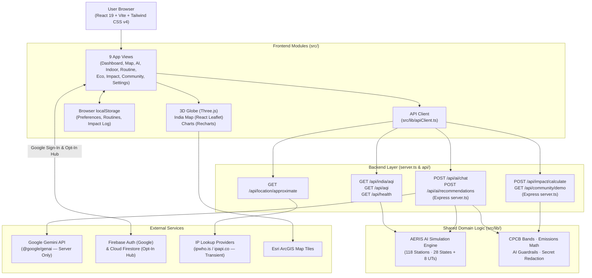

# AERIS AI

### Breathe Smarter. Live Better.

**Created and Developed by Annanya Bagga**

[](https://aeris-ai-alpha.vercel.app/)
[](https://react.dev/)
[](https://www.typescriptlang.org/)
[](https://vite.dev/)
[](https://expressjs.com/)
[](https://firebase.google.com/)
[](https://ai.google.dev/)

**AERIS AI** is an AI-powered environmental technology and air quality monitoring assistant built for households and commuters across India. It combines an interactive 3D atmospheric Earth visualization, a Leaflet-based India-wide monitoring map, deterministic India-wide simulated AQI telemetry across all **28 Indian states and 8 Union Territories**, indoor air optimization tools, adaptive daily routine planning, commute CO2e impact calculation, an opt-in community sustainability hub, and a server-side Google Gemini conversational advisor.

> **Transparency Notice:** Air quality readings in AERIS AI are generated by the built-in **AERIS AI Simulation Engine** (`SIMULATED` data) for demonstration and educational planning. They are **not** live government or Central Pollution Control Board (CPCB) sensor measurements and should not be used for medical or emergency decisions.

---

## Table of Contents

- [Live Demo](#live-demo)
- [About the Project](#about-the-project)
- [Key Features](#key-features)
- [Screenshots](#screenshots)
- [Technology Stack](#technology-stack)
- [Project Architecture](#project-architecture)
- [How to Run Locally](#how-to-run-locally)
- [Environment Variables](#environment-variables)
- [API Documentation](#api-documentation)
- [Firebase Configuration](#firebase-configuration)
- [Gemini AI Configuration](#gemini-ai-configuration)
- [Deployment on Vercel](#deployment-on-vercel)
- [Data Accuracy and Privacy](#data-accuracy-and-privacy)
- [Project Folder Structure](#project-folder-structure)
- [Troubleshooting](#troubleshooting)
- [Future Improvements](#future-improvements)
- [Contribution Guidelines](#contribution-guidelines)
- [License](#license)
- [Author and Contact](#author-and-contact)
- [Acknowledgements](#acknowledgements)

---

## Live Demo

Experience the deployed web application on Vercel:

- **Live URL:** [https://aeris-ai-alpha.vercel.app/](https://aeris-ai-alpha.vercel.app/)

[](https://aeris-ai-alpha.vercel.app/)

---

## About the Project

Urban air pollution and seasonal winter smog affect millions of residents across Indian cities—from dense northern plains metros to coastal, southern, eastern, western, central, northeastern, and island regions. Even when people see an AQI number, it is often unclear how to translate pollutant metrics into practical daily choices: when to ventilate a room, what air purifier CADR fits a bedroom, whether walking or cycling is safe today, or how to adjust schedules for children and older adults.

**AERIS AI** addresses this gap by pairing pan-India air quality visualization with actionable, household-aware guidance:

- **Intended Users:** Indian families, parents planning school commutes, older adults and pollution-sensitive households, daily commuters comparing lower-emission transit modes, and environmentally conscious residents.
- **Core Purpose:** Turn India-wide AQI categories (Good, Satisfactory, Moderate, Poor, Very Poor, Severe) and pollutant profiles (`PM2.5`, `PM10`, `NO2`, `SO2`, `CO`, `O3`, `NH3`) into clear, non-medical precautionary recommendations, indoor air strategies, and sustainable habit tracking.
- **Environmental Awareness Goals:** Encourage lower-emission commuting (metro rail, bus, carpooling, and safe active mobility when air quality permits), raise awareness of indoor pollution sources (cooking smoke, incense, mosquito coils), and support opt-in anonymous community sustainability actions.

---

## Key Features

The table below documents every implemented feature in the codebase and clearly distinguishes live/working modules from simulated, demo, or configuration-dependent functionality.

| Feature | Status | Implementation Details |
| --- | --- | --- |
| **Air Quality Dashboard & 3D Atmospheric Globe** | Working (`SIMULATED` AQI) | Displays selected city AQI, CPCB category badge, predominant pollutant, pollutant cards, station switcher, CPCB health guidance panel, and an interactive **Three.js** photorealistic 3D Earth (`EarthScene.tsx`) with NASA-style surface/normal/specular/cloud textures, atmospheric glow shader, AQI-reactive urban pollution halos/particles, station markers, and Pause/Focus controls. |
| **India-Wide AQI Map** | Working (`SIMULATED` AQI) | Interactive **React Leaflet + Leaflet + Leaflet.markercluster** map (`IndiaStationMap.tsx`) over Esri ArcGIS dark gray and satellite imagery basemaps. Plots **118 stations** across **all 28 Indian states and 8 Union Territories** using fixed, real city/station coordinates, with state, city, search, and CPCB category filters, marker clustering, fullscreen mode, and clickable station inspection drawers. |
| **Simulated India-Wide Air Quality API** | Working (`SIMULATED`) | Deterministic **AERIS AI Simulation Engine** (`src/lib/indiaSimulation.ts`) serving consistent JSON snapshots on a configurable interval (default 15 minutes) across 28 states and 8 UTs with explicit `SIMULATED` metadata and disclaimers. |
| **City & Location Detection** | Working (Multi-tier fallback) | Attempts browser `navigator.geolocation` first (with `Permissions-Policy` and denial detection so it does not repeatedly prompt), falls back to server-side approximate IP city detection (`GET /api/location/approximate` via `ipwho.is` with `ipapi.co` fallback, zero coordinate storage), and provides a searchable manual selector covering all Indian states and UTs. |
| **AI-Powered Air Quality Advisor** | Working (Requires Express server + `GEMINI_API_KEY`) | Conversational assistant (`AiAssistantPage.tsx`) backed by server-side `@google/genai` (`POST /api/ai/chat` and `POST /api/ai/recommendations`). Uses current simulated city/station context and household preferences to return structured JSON guidance (summary, risk tier, do/avoid actions, indoor advice, commute advice, morning/afternoon/evening schedule, reasoning, and data-limitation caveats). |
| **Indoor Air Quality Optimizer** | Working | Room dimensions calculator (`IndoorOptimizerPage.tsx`) computing room area, volume, dynamic Air Changes per Hour (ACH) based on outdoor AQI, and recommended purifier CADR; adaptive ventilation schedules; True HEPA / DIY box-fan / no-purifier guidance; practical hygiene checklist saved in `localStorage`; and science-backed caveats (explicitly rejecting houseplant air-cleaning myths). |
| **Smart Daily Routine Planner** | Working | Generates personalized Morning, Afternoon, and Evening routines (`RoutinePlannerPage.tsx`) tailored to household profile (children, older adults, pollution-sensitive members, office/school/home schedule, exercise preference) and current AQI band, with a daily resettable checklist stored in `localStorage`. |
| **Eco-Friendly Alternatives & Commute Calculator** | Working | Compares solo car and two-wheeler commutes against metro rail, public bus, carpool, walking, and cycling (`EcoAlternativesPage.tsx`) using sourced India transport emission factors (`src/lib/emissions.ts`), calculates CO2e avoided, and enforces an AQI safety gate that blocks unsafe outdoor walking/cycling recommendations during high pollution. |
| **Environmental Impact Tracker** | Working (Browser `localStorage`) | Logs personal eco-commute and indoor-air actions (`ImpactTrackerPage.tsx`), tracks streaks, displays monthly/weekly **Recharts** visualizations, and separates quantified CO2e-avoided actions from qualitative habits without inventing numbers. |
| **Community Sustainability Hub** | Dual Mode (**Demo** by default / **Live** with Firebase) | Displays clearly labeled **Demo Community Reference Data** when signed out or not opted in. When signed in with **Firebase Google Authentication** and explicitly opted in, supports live anonymous contributions and community challenge participation persisted in **Cloud Firestore** with strict PII filtering and security rules. |
| **User Authentication** | Working (Requires Firebase Auth config) | Google Sign-In (`signInWithPopup`) and Sign-Out via Firebase Authentication (`src/lib/firebase.ts`), with actionable error diagnostics for `auth/configuration-not-found`, `auth/operation-not-allowed`, and `auth/unauthorized-domain`. |
| **Preferences & Health Diagnostics** | Working | Household configuration (city, household size, children, older adults, sensitivity, commute mode, work hours, anonymous handle), live backend health inspection (`GET /api/health`), and non-secret Firebase/Gemini status indicators (`SettingsPage.tsx`). |
| **Responsive UI** | Working | Adaptive layout with desktop sidebar navigation, collapsible mobile navigation drawer, bottom mobile quick-dock (`Home`, `Map`, `AI`, `Routine`), touch-friendly controls, and React error boundaries. |

> **Note on Vercel Serverless vs. Full Express Backend:** The repository currently provides standalone Vercel serverless functions in `api/` for `GET /api/health`, `GET /api/india/aqi`, `GET /api/aqi`, and `GET /api/location/approximate`. Endpoints that are currently registered only inside `server.ts` (`POST /api/ai/chat`, `POST /api/ai/recommendations`, `POST /api/impact/calculate`, `GET /api/community/demo`) require either running `server.ts` (locally or on a Node host referenced via `VITE_API_BASE_URL`) or adding matching serverless handlers under `api/`.

---

## Screenshots

Placeholder slots are provided below so screenshots can be added after capturing images of the live application (for example, inside a `docs/screenshots/` folder):

| View | Preview Placeholder |
| --- | --- |
| **Air Quality Dashboard & 3D Earth** | `<!-- Add screenshot:  -->` *(Screenshot to be added)* |
| **India-Wide Interactive AQI Map** | `<!-- Add screenshot:  -->` *(Screenshot to be added)* |
| **Gemini AI Air Quality Advisor** | `<!-- Add screenshot:  -->` *(Screenshot to be added)* |
| **Indoor Air Optimizer & Daily Routine** | `<!-- Add screenshot:  -->` *(Screenshot to be added)* |
| **Eco Transport & Impact Tracker** | `<!-- Add screenshot:  -->` *(Screenshot to be added)* |
| **Community Sustainability Hub** | `<!-- Add screenshot:  -->` *(Screenshot to be added)* |

---

## Technology Stack

Verified directly from `package.json` and the project source files:

### Frontend
- **Framework:** React `19` (`react`, `react-dom`)
- **Language:** TypeScript (`typescript`)
- **Build Tool & Dev Bundler:** Vite `8` (`vite`, `@vitejs/plugin-react`)
- **Styling:** Tailwind CSS `v4` (`tailwindcss`, `@tailwindcss/vite`, `autoprefixer`)
- **Animations:** Motion (`motion` / `motion/react`)
- **Icons:** Lucide React (`lucide-react`)
- **3D Visualization:** Three.js (`three`) with custom shaders and NASA-style Earth texture maps (`public/textures/earth/`)
- **Geospatial Mapping:** Leaflet (`leaflet`), React Leaflet `v5` (`react-leaflet`), Leaflet.markercluster (`leaflet.markercluster`), Esri ArcGIS Dark Gray & World Imagery map tiles
- **Charts & Data Visualization:** Recharts (`recharts`)

### Backend & Serverless
- **Runtime:** Node.js (ESM, `"type": "module"`)
- **Web Server:** Express `4` (`express`) in `server.ts`
- **TypeScript Runner:** `tsx` (development server and `node:test` unit tests)
- **Serverless Handlers:** Native Node `http` (`IncomingMessage` / `ServerResponse`) functions in `api/` for Vercel deployment
- **Environment Loading:** `dotenv`

### AI, Authentication & Database
- **AI SDK:** Google Gen AI SDK (`@google/genai`) invoked server-side in `server/ai/gemini.ts`
- **Authentication & Database:** Firebase Web SDK `v13` (`firebase/app`, `firebase/auth`, `firebase/firestore`)
- **Security Rules & Validation:** Cloud Firestore Rules (`firestore.rules`), Firebase Storage Rules (`storage.rules`), `@firebase/eslint-plugin-security-rules`, ESLint `10`

### Deployment & Hosting
- **Live Hosting:** Vercel ([https://aeris-ai-alpha.vercel.app/](https://aeris-ai-alpha.vercel.app/))

---

## Project Architecture

AERIS AI uses a unified TypeScript architecture with pure, shared domain modules (`src/lib/`) reused across the React frontend, the Express server (`server.ts`), and the serverless API handlers (`api/`):

1. **React SPA (`src/`):** Manages navigation across 9 views (`Dashboard`, `Pollution Map`, `AI Advisor`, `Indoor Air`, `Daily Routine`, `Eco Transport`, `Impact Tracker`, `Community Hub`, `Preferences`), persists household settings and personal checklists/impact logs in browser `localStorage`, and communicates with backend endpoints through `src/lib/apiClient.ts`.
2. **Express Server (`server.ts`):** Serves all `/api/*` endpoints, attaches security headers (`X-Content-Type-Options`, `Referrer-Policy`, `Permissions-Policy`), handles unmatched `/api/*` paths with structured JSON 404 responses, mounts Vite middleware in development, and serves built `dist/` files in production.
3. **Serverless API Layer (`api/`):** Exposes `GET /api/india/aqi`, `GET /api/aqi`, `GET /api/health`, and `GET /api/location/approximate` directly for serverless deployments such as Vercel.
4. **Simulation Engine (`src/lib/indiaSimulation.ts` & `src/lib/aqi.ts`):** Generates deterministic India-wide AQI and pollutant values for 118 fixed station coordinates spanning 28 states and 8 UTs, classified using CPCB 0–500 thresholds.
5. **Server-Side AI Layer (`server/ai/gemini.ts`):** Reads `GEMINI_API_KEY` exclusively on the server, injects current simulated AQI context, household profile, and strict non-medical/transparency system instructions, requests structured JSON output from `@google/genai`, and enforces response guardrails (`src/lib/aiContext.ts`).
6. **Firebase Auth & Firestore (`src/lib/firebase.ts` & `firestore.rules`):** Handles optional Google Sign-In and live opt-in anonymous community collections (`community_contributions`, `community_challenges`, `challenge_participants`), kept strictly isolated from demo community reference data.



---

## How to Run Locally

### Prerequisites

- **Node.js:** v20.x or higher recommended (**Node.js v22+** required if running `npm start` directly via `node server.ts`; verified on Node.js `v22.23.2`).
- **npm:** Included with Node.js (matches all scripts in `package.json`).
- **Git:** For cloning the repository.
- **Optional Credentials:**
  - A **Google Gemini API key** (`GEMINI_API_KEY`) if you want live AI Advisor responses.
  - A **Firebase project** (`VITE_FIREBASE_*`) if you want Google Sign-In and live opt-in Firestore storage in the Community Hub.
  - *(The Dashboard, 3D Earth, India AQI Map, Indoor Optimizer, Routine Planner, Eco Calculator, Impact Tracker, and Demo Community Hub run out of the box without any external keys.)*

### Step 1: Clone the Repository

Replace the placeholder below with your actual GitHub repository URL and folder name:

```bash
git clone https://github.com/annanyabagga01/YOUR_ACTUAL_REPOSITORY_NAME.git
cd YOUR_ACTUAL_PROJECT_FOLDER
```

### Step 2: Install Dependencies

```bash
npm install
```

### Step 3: Configure Environment Variables

Create a `.env` file in the project root by copying `.env.example`:

```bash
cp .env.example .env
```

Open `.env` and fill in any optional keys you intend to use (see [Environment Variables](#environment-variables) below). Never commit `.env` to Git—it is already excluded by `.gitignore`.

### Step 4: Start the Development Server

Run the full-stack Express + Vite development server (listening on port `3000` by default):

```bash
npm run dev
```

### Step 5: Open in Your Browser

Visit:

```text
http://localhost:3000
```

You can also verify the backend health endpoint directly at:

```text
http://localhost:3000/api/health
```

### Additional `package.json` Scripts & Unit Tests

```bash
npm run lint     # TypeScript type-checking (tsc --noEmit)
npm run build    # Build production frontend bundle into dist/
npm start        # Run production Express server (node server.ts) on port 3000
npm run preview  # Preview static Vite build locally (without Express server)
npm run clean    # Remove dist/ and server.js build artifacts

# Run all unit tests (53 tests across src/lib/*.test.ts)
npx tsx --test src/lib/*.test.ts
```

---

## Environment Variables

All environment variables referenced in the codebase are listed below.

| Variable Name | Scope | Required / Optional | Purpose |
| --- | --- | --- | --- |
| `GEMINI_API_KEY` | **Backend only** | Optional *(Required for AI Advisor)* | Server-side API key for `@google/genai` used by `POST /api/ai/chat` and `POST /api/ai/recommendations`. |
| `SIMULATION_INTERVAL_MS` | **Backend only** | Optional *(Default: `900000` = 15 min)* | Deterministic refresh interval (in milliseconds) for the AERIS AI India-wide simulated AQI engine. |
| `PORT` | **Backend only** | Optional *(Default: `3000`)* | Listening port for the Express server (`server.ts`). |
| `NODE_ENV` | **Backend only** | Optional | Set to `production` to serve built `dist/` static assets from `server.ts` instead of Vite dev middleware. |
| `APP_URL` | **Backend / Docs** | Optional *(Default: `http://localhost:3000`)* | Public base URL reference where the app is hosted. |
| `VITE_API_BASE_URL` | **Frontend** | Optional *(Leave empty for same-origin)* | Base URL of a separately hosted Express API (only needed if frontend and backend live on different origins). |
| `VITE_API_PROXY_TARGET` | **Dev Tooling** | Optional | Target origin used by `vite.config.ts` to proxy `/api` when running standalone `vite`. |
| `DISABLE_HMR` | **Dev Tooling** | Optional | When set to `true`, disables Vite HMR and file watching in hosted IDE sandboxes. |
| `VITE_FIREBASE_API_KEY` | **Frontend** | Optional *(Required for live Auth/Firestore)* | Public Firebase Web API key identifier. |
| `VITE_FIREBASE_AUTH_DOMAIN` | **Frontend** | Optional *(Required for live Auth/Firestore)* | Firebase Auth domain (e.g., `your-project-id.firebaseapp.com`). |
| `VITE_FIREBASE_PROJECT_ID` | **Frontend** | Optional *(Required for live Auth/Firestore)* | Firebase project ID. |
| `VITE_FIREBASE_STORAGE_BUCKET` | **Frontend** | Optional *(Required for live Auth/Firestore)* | Firebase Storage bucket domain. |
| `VITE_FIREBASE_MESSAGING_SENDER_ID` | **Frontend** | Optional *(Required for live Auth/Firestore)* | Firebase Messaging sender ID. |
| `VITE_FIREBASE_APP_ID` | **Frontend** | Optional *(Required for live Auth/Firestore)* | Firebase Web App ID. |
| `VITE_FIREBASE_DATABASE_ID` | **Frontend** | Optional *(Default: `(default)`)* | Firestore database ID if using a named Firestore database. |

### Frontend vs. Backend Security Rules

- **Backend-only variables (`GEMINI_API_KEY`, `PORT`, `SIMULATION_INTERVAL_MS`)** must **never** be prefixed with `VITE_`. Vite embeds any `VITE_*` variable into the public browser bundle.
- **Frontend variables (`VITE_FIREBASE_*`, `VITE_API_BASE_URL`)** are public client configuration identifiers—not secrets. Firebase access is protected through hardened **Firestore Security Rules** (`firestore.rules`), default-deny **Storage Rules** (`storage.rules`), and Google Cloud API key referrer/API restrictions.

### Safe `.env.example` Template

```env
# ==============================================================================
# SERVER-SIDE SECRETS & CONFIGURATION (NEVER prefix secrets with VITE_)
# ==============================================================================
GEMINI_API_KEY="YOUR_GEMINI_API_KEY"
SIMULATION_INTERVAL_MS="900000"
APP_URL="http://localhost:3000"
PORT="3000"

# Optional: only set if frontend and Express API are hosted on different origins
# VITE_API_BASE_URL=""

# ==============================================================================
# CLIENT-SIDE FIREBASE WEB CONFIG (Public browser identifiers — NOT secrets)
# ==============================================================================
VITE_FIREBASE_API_KEY="YOUR_FIREBASE_WEB_API_KEY"
VITE_FIREBASE_AUTH_DOMAIN="your-project-id.firebaseapp.com"
VITE_FIREBASE_PROJECT_ID="your-project-id"
VITE_FIREBASE_STORAGE_BUCKET="your-project-id.firebasestorage.app"
VITE_FIREBASE_MESSAGING_SENDER_ID="YOUR_MESSAGING_SENDER_ID"
VITE_FIREBASE_APP_ID="1:000000000000:web:0000000000000000000000"
VITE_FIREBASE_DATABASE_ID="(default)"
```

---

## API Documentation

> **Important:** All AQI endpoints below return **`SIMULATED`** data generated by the **AERIS AI Simulation Engine** for demonstration purposes. None of these endpoints connect to CPCB, `data.gov.in`, or live physical air quality monitors.

### 1. India-Wide Simulated AQI API *(Express + Vercel Serverless)*

- **Method & Route:** `GET /api/india/aqi`
- **Purpose:** Returns deterministic simulated AQI readings for **118 stations across all 28 Indian states and 8 Union Territories**, using static verified city/station coordinates.
- **Query Parameters (all optional):**
  - `state` — Filter by state or Union Territory name/code (e.g., `Kerala`, `DL`, `Maharashtra`)
  - `city` — Filter by city name or common alias (e.g., `Delhi`, `Kochi`, `Bombay`, `Kochi, Kerala`)
  - `category` — Filter by CPCB category (`Good`, `Satisfactory`, `Moderate`, `Poor`, `Very Poor`, `Severe`)
  - `search` — Free-text filter across station name, city, and state
  - `includeCityDetail` — Set to `1` or `true` to include full `cityDetail` object for the selected `city`
  - `station` — Optional preferred station name when `includeCityDetail=1`

**Example Request:**

```bash
curl "http://localhost:3000/api/india/aqi?state=Kerala"
```

**Example Response (`200 OK`):**

```json
{
  "success": true,
  "data_type": "SIMULATED",
  "data_source": "AERIS AI Simulation Engine",
  "generated_at": "2026-11-19T08:00:00.000Z",
  "total_stations": 4,
  "stations": [
    {
      "id": "sim-kerala-kochi-vytilla",
      "station_name": "Vyttila Mobility Hub, Kochi",
      "city": "Kochi",
      "state": "Kerala",
      "state_code": "KL",
      "latitude": 9.9685,
      "longitude": 76.3183,
      "aqi": 74,
      "category": "Satisfactory",
      "predominant_pollutant": "PM2.5",
      "pm25": 42,
      "pm10": 68,
      "no2": 18,
      "so2": 9,
      "co": 0.7,
      "o3": 29,
      "nh3": 11,
      "last_updated": "2026-11-19T08:00:00.000Z",
      "data_type": "SIMULATED",
      "data_source": "AERIS AI Simulation Engine"
    }
  ],
  "summary": {
    "totalStations": 4,
    "statesCovered": 1,
    "unionTerritoriesCovered": 0
  }
}
```

- **Error Codes:**
  - `404 Not Found` — Returned as JSON when `includeCityDetail=1` is requested for an unknown city (includes `supportedCities`).
  - `405 Method Not Allowed` — Non-GET/HEAD request on the serverless handler.
  - `500 Internal Server Error` — Unexpected generation failure.

---

### 2. Single-City Simulated AQI Endpoint *(Express + Vercel Serverless)*

- **Method & Route:** `GET /api/aqi`
- **Purpose:** Returns detailed simulated AQI, station list, pollutant readings, and metadata for a single Indian city (defaults to `Delhi` if `city` is omitted).
- **Query Parameters:** `city` (optional), `station` (optional).

**Example Request:**

```bash
curl "http://localhost:3000/api/aqi?city=Delhi"
```

**Example Response (`200 OK`):**

```json
{
  "success": true,
  "data_type": "SIMULATED",
  "data_source": "AERIS AI Simulation Engine",
  "generated_at": "2026-11-19T08:00:00.000Z",
  "total_stations": 10,
  "city": "Delhi",
  "state": "Delhi",
  "primaryAqi": 318,
  "category": "Very Poor",
  "dataType": "SIMULATED",
  "dataSource": "AERIS AI Simulation Engine",
  "stations": []
}
```

- **Error Codes:** `404 Not Found` (unsupported city), `405 Method Not Allowed` (serverless), `500 Internal Server Error`.

---

### 3. Backend Health Check *(Express + Vercel Serverless)*

- **Method & Route:** `GET /api/health`
- **Purpose:** Verifies API availability, simulation engine coverage, and non-secret boolean status of Gemini and Firebase configuration.

**Example Request:**

```bash
curl "http://localhost:3000/api/health"
```

**Example Response (`200 OK`):**

```json
{
  "success": true,
  "status": "ok",
  "timestampIso": "2026-11-19T08:05:00.000Z",
  "endpoints": [
    "/api/health",
    "/api/india/aqi",
    "/api/aqi",
    "/api/location/approximate",
    "/api/community/demo"
  ],
  "integrations": {
    "geminiConfigured": true,
    "firebaseConfigured": true,
    "simulationEngineActive": true
  },
  "simulationEngine": {
    "dataSource": "AERIS AI Simulation Engine",
    "dataType": "SIMULATED",
    "totalStations": 118,
    "statesCovered": 28,
    "unionTerritoriesCovered": 8,
    "intervalMs": 900000
  }
}
```

---

### 4. Approximate IP City Detection *(Express + Vercel Serverless)*

- **Method & Route:** `GET /api/location/approximate`
- **Purpose:** Fallback location helper when browser GPS is unavailable or blocked. Performs a transient, zero-storage server-side IP lookup (`ipwho.is`, falling back to `ipapi.co`) and maps Indian IPs to the closest city in the AERIS AI catalog. Private/loopback IPs or non-Indian IPs return `detected: false` honestly.

**Example Request:**

```bash
curl "http://localhost:3000/api/location/approximate"
```

**Example Response (`200 OK`):**

```json
{
  "detected": false,
  "city": null,
  "state": null,
  "stateCode": null,
  "region": null,
  "detectionMethod": "unavailable",
  "isApproximate": true,
  "coordinatesStored": false,
  "provider": null,
  "reason": "private_ip",
  "message": "Approximate IP location is unavailable on a local/private network address. Please select an Indian city manually."
}
```

---

### 5. Gemini AI Recommendations & Chat *(Express `server.ts`)*

- **Method & Routes:** `POST /api/ai/recommendations` and `POST /api/ai/chat`
- **Purpose:** Sends the selected city's current simulated AQI context, user household preferences, question, and bounded chat history (max 8 turns) to Google Gemini on the server and returns guardrail-checked structured JSON advice.

**Example Request:**

```bash
curl -X POST "http://localhost:3000/api/ai/chat" \
  -H "Content-Type: application/json" \
  -d '{
    "city": "Delhi",
    "question": "Is it safe for a morning walk today?",
    "preferences": {
      "city": "Delhi",
      "householdSize": 4,
      "hasChildren": true,
      "hasOlderAdults": false,
      "pollutionSensitiveHousehold": true,
      "commuteMode": "metro",
      "workStartHour": "09:00",
      "workEndHour": "18:00",
      "preferredExerciseTime": "morning",
      "anonymousHandle": "UrbanResident_01",
      "communityOptIn": false
    }
  }'
```

**Example Response (`200 OK`):**

```json
{
  "verifiedContext": {
    "city": "Delhi",
    "primaryAqi": 318,
    "category": "Very Poor",
    "dataSource": "AERIS AI Simulation Engine",
    "dataType": "SIMULATED",
    "isLiveVerified": false
  },
  "recommendation": {
    "summary": "...",
    "currentRisk": "Very Poor (301–400, Simulated Demo Data)",
    "recommendedActions": ["..."],
    "avoidActions": ["..."],
    "indoorAdvice": ["..."],
    "commuteAdvice": ["..."],
    "dailySchedule": {
      "morning": "...",
      "afternoon": "...",
      "evening": "..."
    },
    "reasoning": "...",
    "sourceReferences": ["..."],
    "dataLimitations": "..."
  }
}
```

- **Error Codes:**
  - `400 Bad Request` — Missing `city` or `preferences`.
  - `404 Not Found` — City is not in the supported Indian city catalog.
  - `429 Too Many Requests` — Gemini API rate limit or quota reached.
  - `503 Service Unavailable` — `GEMINI_API_KEY` not configured on the server, service busy, or request timed out.
  - `500 Internal Server Error` — Other server-side failure (with secrets automatically redacted).

---

### 6. Server-Side Commute Emissions Calculator *(Express `server.ts`)*

- **Method & Route:** `POST /api/impact/calculate`
- **Purpose:** Computes estimated weekly and monthly CO2e avoided and evaluates active-mobility AQI safety.

**Example Request:**

```bash
curl -X POST "http://localhost:3000/api/impact/calculate" \
  -H "Content-Type: application/json" \
  -d '{
    "baselineMode": "solo_car",
    "alternativeMode": "metro",
    "oneWayDistanceKm": 12,
    "tripsPerWeek": 10,
    "aqi": 220,
    "pollutionSensitiveHousehold": false
  }'
```

- **Error Codes:** `400 Bad Request` for invalid mode, non-finite numbers, or non-positive distance/trips.

---

### 7. Demo Community Dataset *(Express `server.ts`)*

- **Method & Route:** `GET /api/community/demo`
- **Purpose:** Returns clearly labeled reference challenges and sample contributions displayed when the user is signed out or has not opted into live Firestore community features.

**Example Response (`200 OK`):**

```json
{
  "success": true,
  "isDemo": true,
  "disclaimer": "Demo Community Reference Data. Sign in with Google and opt in to submit and view live anonymous Firestore community actions.",
  "challenges": [],
  "contributions": []
}
```

---

### 8. Unmatched `/api/*` Fallback *(Express `server.ts`)*

Any unregistered `/api/*` path returns HTTP `404` with `Content-Type: application/json`:

```json
{
  "success": false,
  "error": "API route not found: GET /api/unknown",
  "availableEndpoints": [
    "GET /api/health",
    "GET /api/india/aqi",
    "GET /api/aqi",
    "GET /api/location/approximate",
    "GET /api/community/demo",
    "POST /api/ai/chat",
    "POST /api/ai/recommendations",
    "POST /api/impact/calculate"
  ]
}
```

---

## Firebase Configuration

Firebase is **optional** for core air quality monitoring, indoor optimization, daily routines, and impact tracking, but **required** if you want Google Sign-In and live opt-in Cloud Firestore persistence in the **Community Sustainability Hub**.

### Step-by-Step Setup

1. **Create or Select a Firebase Project:**
   Open the [Firebase Console](https://console.firebase.google.com/) and create a new project or select an existing one.
2. **Register a Web App:**
   Go to **Project Settings > General > Your apps > Add app (Web)** and copy the generated `apiKey`, `authDomain`, `projectId`, `storageBucket`, `messagingSenderId`, and `appId`.
3. **Configure Environment Variables:**
   Add the `VITE_FIREBASE_*` values to your local `.env` file and to your Vercel project environment variables. Ensure `VITE_FIREBASE_AUTH_DOMAIN` matches your Firebase project's auth domain (`<project-id>.firebaseapp.com`).
4. **Enable Google Authentication:**
   In Firebase Console, navigate to **Build > Authentication > Get started > Sign-in method**, select **Google**, enable it, configure a project support email, and click **Save**.
   *(Without enabling Google Sign-In in the Firebase Console, clicking Sign In will return `auth/configuration-not-found` or `auth/operation-not-allowed`.)*
5. **Add Authorized Domains:**
   Under **Authentication > Settings > Authorized domains**, verify that the following domains are listed:
   - `localhost` (for local development)
   - `aeris-ai-alpha.vercel.app` (or your custom deployment domain)
6. **Provision Cloud Firestore:**
   Navigate to **Build > Firestore Database > Create database** and choose a region (such as `asia-south1` for India). If you use a named database rather than `(default)`, set `VITE_FIREBASE_DATABASE_ID` accordingly.
7. **Deploy Security Rules:**
   Apply the repository's hardened rules from `firestore.rules` and `storage.rules` in Firebase Console (or via Firebase CLI):
   - **`firestore.rules`**: Default-deny safety net; enforces verified Google Auth (`email_verified == true`), UID ownership (`authorUid == request.auth.uid`), explicit opt-in (`optInPublic == true`), server timestamps (`request.time`), strict schema allowlists, and non-editable contributions (create & owner-delete only) across `community_contributions`, `community_challenges`, and `challenge_participants`.
   - **`storage.rules`**: Default-deny across all paths (AERIS AI does not store user file uploads in Cloud Storage).
8. **Restrict the Browser API Key (Recommended):**
   In Google Cloud Console > **APIs & Services > Credentials**, add HTTP referrer restrictions (your local/production domains) and restrict the Firebase Web API key to required Firebase Identity/Firestore APIs only.

---

## Gemini AI Configuration

The **AI Advisor** (`AiAssistantPage.tsx`) uses the official `@google/genai` SDK strictly on the backend (`server/ai/gemini.ts`).

1. **Obtain a Gemini API Key:**
   Generate a key in [Google AI Studio](https://aistudio.google.com/apikey).
2. **Keep the Key Server-Side Only:**
   - Set `GEMINI_API_KEY` in your local `.env` file or server secrets manager.
   - **Never** rename it to `VITE_GEMINI_API_KEY`, commit it to Git, or expose it in frontend code.
3. **Behavior When Configured vs. Unconfigured:**
   - When `GEMINI_API_KEY` is configured and requests reach the Express backend (`POST /api/ai/chat` or `POST /api/ai/recommendations`), `server/ai/gemini.ts` calls Google Gemini with structured JSON schema output, a 15-second timeout, secret redaction on errors, and post-processing safety guardrails.
   - When `GEMINI_API_KEY` is missing, the backend responds cleanly with HTTP `503` and a non-secret configuration message without crashing the rest of the application.

---

## Deployment on Vercel

**Live Deployment:** [https://aeris-ai-alpha.vercel.app/](https://aeris-ai-alpha.vercel.app/)

### 1. Import the Repository into Vercel
1. Push your repository to GitHub.
2. Sign in to [Vercel](https://vercel.com/), click **Add New > Project**, and import the repository.

### 2. Configure Build Settings
Vercel automatically detects Vite. Confirm the following settings match `package.json`:
- **Framework Preset:** `Vite`
- **Build Command:** `npm run build`
- **Output Directory:** `dist`
- **Install Command:** `npm install`

### 3. Configure Environment Variables in Vercel
In **Project Settings > Environment Variables**, add:
- `SIMULATION_INTERVAL_MS` (optional, e.g., `900000`)
- `VITE_FIREBASE_API_KEY`, `VITE_FIREBASE_AUTH_DOMAIN`, `VITE_FIREBASE_PROJECT_ID`, `VITE_FIREBASE_STORAGE_BUCKET`, `VITE_FIREBASE_MESSAGING_SENDER_ID`, `VITE_FIREBASE_APP_ID`, `VITE_FIREBASE_DATABASE_ID` (if using live Google Auth & Firestore Community Hub)
- `VITE_API_BASE_URL` *(Optional — set only if you host `server.ts` on a separate Node server so Express-only endpoints such as `/api/ai/chat`, `/api/ai/recommendations`, `/api/impact/calculate`, and `/api/community/demo` route there)*
- `GEMINI_API_KEY` *(Required on whichever Node backend serves `/api/ai/*`)*

### 4. Deploy & Update Automatically
- Click **Deploy** to publish.
- Subsequent pushes to your connected GitHub branch automatically trigger fresh Vercel preview/production builds.

### 5. Vercel Routing & Troubleshooting API 404s
- **Included Vercel Serverless Functions:** This repository includes Node HTTP handlers in `api/india/aqi.ts`, `api/aqi.ts`, `api/health.ts`, and `api/location/approximate.ts`, which Vercel serves automatically at `/api/india/aqi`, `/api/aqi`, `/api/health`, and `/api/location/approximate`.
- **Express-Only Routes:** `POST /api/ai/chat`, `POST /api/ai/recommendations`, `POST /api/impact/calculate`, and `GET /api/community/demo` are currently defined in `server.ts`. On a pure Vercel static + `api/` deployment without an external Express host (`VITE_API_BASE_URL`), those routes are not backed by serverless files yet and will return 404 unless either `server.ts` is hosted separately or corresponding handlers are added under `api/`.
- **After changing environment variables on Vercel:** Always trigger a **Redeploy** so `VITE_*` variables are baked into the new frontend build.

---

## Data Accuracy and Privacy

### Simulated vs. Measured Air Quality
- AERIS AI generates deterministic **SIMULATED** air quality readings (`data_type: "SIMULATED"`, `data_source: "AERIS AI Simulation Engine"`) across 118 fixed Indian station coordinates in all 28 states and 8 Union Territories.
- CPCB AQI category labels (`Good 0–50`, `Satisfactory 51–100`, `Moderate 101–200`, `Poor 201–300`, `Very Poor 301–400`, `Severe 401–500`) are used strictly for demonstration and educational interpretation.
- All health guidance is **non-medical and precautionary**—AERIS AI does not diagnose conditions, prescribe treatment, or claim that masks or air purifiers guarantee complete protection.

### Location Permissions & Zero GPS Storage
- **Browser Geolocation:** Requested only when the user explicitly clicks the nearest-city detection control. If blocked by iframe `Permissions-Policy`, unavailable, or denied, the app stops retrying automatically and falls back cleanly.
- **No Persistent GPS Storage:** Coordinates obtained transiently for nearest-city matching are **not** stored in `localStorage`, sent to Firestore, or logged by the backend.
- **IP Fallback:** `GET /api/location/approximate` transiently resolves the client IP via `ipwho.is` (with `ipapi.co` fallback) to return an approximate Indian city name and state with `coordinatesStored: false` and `Cache-Control: no-store`.
- **Manual City Selection:** Users can select any supported Indian city across all 28 states and 8 UTs at any time without sharing location permissions.

### Local Storage & Community Privacy
- Household preferences, indoor checklist state, daily routine state, and personal impact logs are stored locally in the user's browser via `localStorage` (`aeris_ai_preferences_v1`, `aeris_ai_impact_log_v1`, `aeris_ai_indoor_optimizer_v1`, `aeris_ai_routine_planner_v1`).
- Live Community Hub submissions require explicit sign-in and opt-in, use anonymous handles, and run client-side PII checks (`src/lib/community.ts` and `src/lib/firebase.ts`) to block emails, phone numbers, account display names, or sensitive address strings before writing to Firestore.

---

## Project Folder Structure

```text
.
├── api/                                # Standalone Vercel serverless API handlers
│   ├── aqi.ts                          # GET /api/aqi (single-city simulated AQI)
│   ├── health.ts                       # GET /api/health (service health & config flags)
│   ├── india/
│   │   └── aqi.ts                      # GET /api/india/aqi (all 28 states & 8 UTs)
│   └── location/
│       └── approximate.ts              # GET /api/location/approximate (transient IP fallback)
├── public/
│   └── textures/
│       └── earth/                      # Photorealistic Earth day, normal, specular, cloud & night maps
├── server/
│   ├── adapters/
│   │   └── demoData.ts                 # Reference Demo Community challenges & contributions
│   ├── ai/
│   │   └── gemini.ts                   # Server-side @google/genai client, schema & error handling
│   ├── location.ts                     # Transient IP geolocation resolver (ipwho.is / ipapi.co)
│   └── security.ts                     # Secret redaction helper for logs and API error messages
├── src/
│   ├── components/
│   │   ├── AqiBadge.tsx                # CPCB category badge component
│   │   ├── CpcbHealthEnginePanel.tsx   # Household-aware CPCB precautionary health panel
│   │   ├── EarthScene.tsx              # Three.js interactive 3D atmospheric pollution globe
│   │   ├── ErrorBoundary.tsx           # React error boundary wrapper
│   │   ├── IndiaStationMap.tsx         # React Leaflet + markercluster India AQI map
│   │   └── SkeletonCards.tsx           # Loading skeleton placeholders
│   ├── lib/
│   │   ├── aiContext.ts                # AI prompt context helpers & response guardrails
│   │   ├── apiClient.ts                # Same-origin / VITE_API_BASE_URL request builder
│   │   ├── aqi.ts                      # CPCB category thresholds, Indian city catalog & math
│   │   ├── community.ts                # Anonymous handle validation & PII filtering
│   │   ├── cpcbHealth.ts               # CPCB health implication rules by band & sensitivity
│   │   ├── earthPollution.ts           # AQI-to-3D visual halo & marker layout calculations
│   │   ├── emissions.ts                # India transport CO2e factors & active-mobility safety gate
│   │   ├── firebase.ts                 # Firebase App, Google Auth & Firestore listeners/mutations
│   │   ├── firebaseConfig.ts           # Safe Firebase config loader & auth error formatter
│   │   ├── indiaSimulation.ts          # Deterministic 118-station India-wide AQI simulation engine
│   │   ├── indoorOptimizer.ts          # Room CADR, ACH & ventilation recommendation engine
│   │   ├── locationDetection.ts        # Geolocation error classification & searchable city catalog
│   │   ├── mapUtils.ts                 # India map bounds, CPCB marker specs & filtering helpers
│   │   ├── routines.ts                 # Adaptive morning/afternoon/evening schedule builder
│   │   ├── storage.ts                  # Browser localStorage persistence helpers
│   │   ├── types.ts                    # Shared TypeScript interfaces
│   │   └── *.test.ts                   # Node test runner unit tests (13 test files, 53 tests)
│   ├── pages/
│   │   ├── AiAssistantPage.tsx         # Conversational Gemini air quality advisor UI
│   │   ├── CommunityHubPage.tsx        # Demo vs. opt-in live Firestore Community Hub
│   │   ├── DashboardPage.tsx           # Main AQI dashboard + 3D Earth overview
│   │   ├── EcoAlternativesPage.tsx     # Commute alternatives & CO2e comparison calculator
│   │   ├── ImpactTrackerPage.tsx       # Personal impact log, streaks & Recharts charts
│   │   ├── IndoorOptimizerPage.tsx     # Room CADR calculator & indoor air checklist
│   │   ├── PollutionMapPage.tsx        # Full India-wide Leaflet station explorer
│   │   ├── RoutinePlannerPage.tsx      # Adaptive daily schedule & checklist
│   │   └── SettingsPage.tsx            # Household profile, city selector & health diagnostics
│   ├── App.tsx                         # Root layout, navigation, state & data fetching
│   ├── index.css                       # Global Tailwind CSS v4 styles
│   └── main.tsx                        # React 19 entry point
├── .env.example                        # Safe environment variable template (placeholders only)
├── .gitignore                          # Excludes node_modules, dist, .env, local secrets
├── eslint.config.js                    # ESLint & Firestore security rules lint config
├── firebase-blueprint.json             # Firestore collection schema blueprint
├── firestore.rules                     # Hardened Cloud Firestore security rules
├── index.html                          # HTML entry point & metadata
├── metadata.json                       # Application metadata
├── package.json                        # Dependencies and npm scripts
├── server.ts                           # Main Node/Express server & Vite dev middleware host
├── storage.rules                       # Default-deny Firebase Storage security rules
├── tsconfig.json                       # TypeScript compiler configuration
└── vite.config.ts                      # Vite 8 build, Tailwind plugin & optional dev API proxy
```

---

## Troubleshooting

### 1. `npm install` Errors
- Confirm your Node.js version (`node -v`) is **v20+** (v22+ recommended for `npm start`).
- Clear the npm cache and reinstall cleanly:
  ```bash
  rm -rf node_modules
  npm cache clean --force
  npm install
  ```

### 2. Development Server Errors (`npm run dev`)
- If port `3000` is already in use, start on another port:
  ```bash
  PORT=3001 npm run dev
  ```
- Confirm `tsx` is installed via `npm install` (it is listed in `devDependencies`).

### 3. API HTTP 404 Errors (`Air quality service returned HTTP 404`)
- **Locally:** Make sure you run `npm run dev` (which launches `server.ts` with Express + Vite), rather than running `vite` alone without `VITE_API_PROXY_TARGET`.
- **On Vercel:** Ensure the `api/` directory (`api/india/aqi.ts`, `api/aqi.ts`, `api/health.ts`, `api/location/approximate.ts`) is committed and deployed. For Express-only endpoints (`/api/ai/*`, `/api/impact/calculate`, `/api/community/demo`), host `server.ts` on a Node backend and configure `VITE_API_BASE_URL` or add corresponding serverless functions in `api/`.
- Test `GET /api/health` and `GET /api/india/aqi` directly in your browser to confirm JSON `200 OK` responses.

### 4. Firebase `auth/configuration-not-found` or `auth/unauthorized-domain`
- **`auth/configuration-not-found` / `auth/operation-not-allowed`:** Open Firebase Console > **Authentication > Sign-in method**, enable **Google**, set a support email, and save.
- **`auth/unauthorized-domain`:** Open Firebase Console > **Authentication > Settings > Authorized domains** and add your active host (e.g., `localhost` or `aeris-ai-alpha.vercel.app`).
- Verify `VITE_FIREBASE_PROJECT_ID` and `VITE_FIREBASE_AUTH_DOMAIN` belong to the exact same Firebase project and redeploy after editing environment variables.

### 5. Missing Environment Variables
- Check `/api/health` to view safe boolean statuses (`geminiConfigured`, `firebaseConfigured`, `simulationEngineActive`).
- Verify `.env` exists in the project root (not inside `src/`) and restart `npm run dev` after any `.env` changes.

### 6. Gemini API Errors (`503`, `429`, or Invalid Key)
- **`503` (not configured):** Set a valid `GEMINI_API_KEY` on the server (never `VITE_GEMINI_API_KEY`) and restart the server.
- **`429` (quota reached):** Wait briefly and retry, or check your Google AI Studio quota/billing tier.
- **Invalid credentials:** Regenerate the key in Google AI Studio and update `.env` or your host's server secrets.

### 7. Vercel Deployment Failures
- Run `npm run lint && npm run build` locally before pushing to catch TypeScript or Vite bundling issues early.
- Confirm Vercel's **Output Directory** is set to `dist` and **Build Command** is `npm run build`.
- Ensure no local secret files are imported directly without optional handling.

### 8. Geolocation Permission Errors (`Permissions-Policy` or Denied)
- Embedded iframes or strict browser settings may disable `navigator.geolocation`. AERIS AI detects this automatically, stops repeating GPS prompts, tries server-side approximate IP detection (`GET /api/location/approximate`), and opens the searchable manual Indian city selector so you can pick any city across all 28 states and 8 UTs immediately.

---

## Future Improvements

The following enhancements are **planned** and not yet implemented:

- **Planned:** Add Vercel serverless handlers for `POST /api/ai/chat`, `POST /api/ai/recommendations`, `POST /api/impact/calculate`, and `GET /api/community/demo` so every API endpoint runs natively on Vercel without a separate Express host.
- **Planned:** Optional integration with verified public live air quality feeds (with clear separation from simulated mode and resilient caching/fallback).
- **Planned:** Historical AQI trend comparison charts and multi-city side-by-side comparison views.
- **Planned:** Multilingual interface support for major Indian regional languages (e.g., Hindi, Tamil, Bengali, Marathi, Telugu, Malayalam).
- **Planned:** Progressive Web App (PWA) installability and opt-in browser notifications for severe smog alerts.
- **Planned:** Automated CI workflow (GitHub Actions) running `npm run lint`, `npm run build`, and `npx tsx --test src/lib/*.test.ts` on every pull request.

---

## Contribution Guidelines

Contributions, bug reports, and documentation improvements are welcome:

1. **Fork the repository** on GitHub.
2. **Create a feature or fix branch** from `main`:
   ```bash
   git checkout -b feat/your-feature-name
   ```
3. **Make your changes** cleanly in TypeScript, preserving strict privacy rules and never committing secrets or `.env` files.
4. **Verify your changes locally** before committing:
   ```bash
   npm run lint
   npm run build
   npx tsx --test src/lib/*.test.ts
   ```
5. **Commit with clear messages** and push to your fork:
   ```bash
   git add .
   git commit -m "feat: describe your change clearly"
   git push origin feat/your-feature-name
   ```
6. **Open a Pull Request** describing the motivation, changes made, and how you tested them.

---

## License

No `LICENSE` file is currently present in this repository, so a formal open-source license has not yet been specified. Until a license is added by the author, all rights remain reserved by **Annanya Bagga**.

---

## Author and Contact

**Annanya Bagga**  
Creator & Developer of **AERIS AI**

- **Portfolio:** [https://annanya-bagga-portfolio.ai.studio](https://annanya-bagga-portfolio.ai.studio)
- **GitHub:** [https://github.com/annanyabagga01](https://github.com/annanyabagga01)
- **LinkedIn:** [https://linkedin.com/in/annanyabagga24](https://linkedin.com/in/annanyabagga24)

---

## Acknowledgements

AERIS AI is built with the following verified open-source libraries, tools, and platforms used in the project:

- [React](https://react.dev/), [TypeScript](https://www.typescriptlang.org/), and [Vite](https://vite.dev/)
- [Tailwind CSS](https://tailwindcss.com/), [Motion](https://motion.dev/), and [Lucide Icons](https://lucide.dev/)
- [Three.js](https://threejs.org/) for the 3D atmospheric Earth scene
- [Leaflet](https://leafletjs.com/), [React Leaflet](https://react-leaflet.js.org/), [Leaflet.markercluster](https://github.com/Leaflet/Leaflet.markercluster), and [Esri ArcGIS Basemaps](https://www.arcgis.com/) for the India-wide interactive map
- [Recharts](https://recharts.org/) for impact analytics charts
- [Node.js](https://nodejs.org/) and [Express](https://expressjs.com/) for the backend API server
- [Google Gen AI SDK (`@google/genai`)](https://ai.google.dev/) for server-side Gemini AI recommendations
- [Firebase Authentication & Cloud Firestore](https://firebase.google.com/) for opt-in Google Sign-In and live community persistence
- [ipwho.is](https://ipwho.is/) and [ipapi.co](https://ipapi.co/) for transient, zero-storage approximate IP city fallback
- [Vercel](https://vercel.com/) for live web hosting and serverless API deployment
